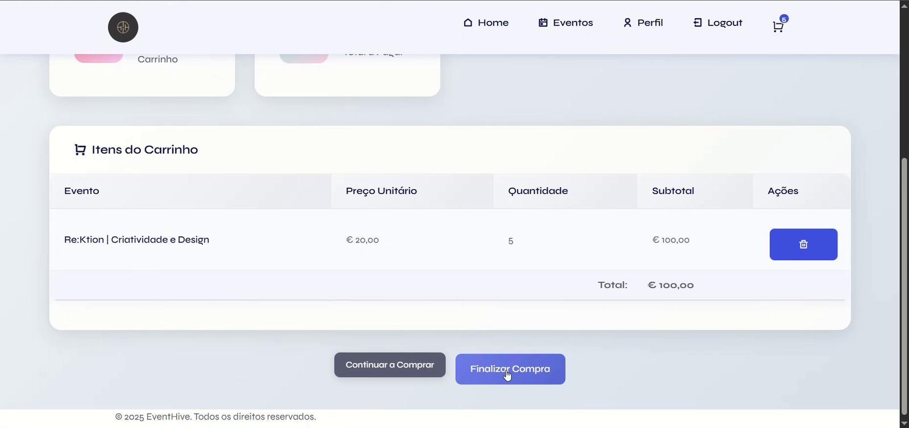
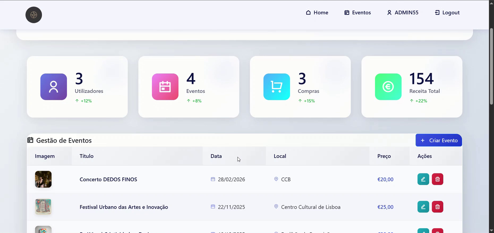

# 🎫 EventHive — Event Management System

Full-stack event ticketing platform developed as the final project of a Web Development professional training course.
Users can browse events, buy tickets and manage their profile, while administrators manage events, users and purchases from a dashboard.

## 📸 Screenshots

## 🚀 Features

### 👤 Users
- Registration and login/logout
- Browse events and view details
- Add tickets to a shopping cart and complete the purchase
- Profile page with purchase history and filters

### 🛠️ Admins
- Dashboard with users, events, purchases and revenue stats
- Full CRUD for events, including image upload
- Manage users and roles
- View and edit ticket purchases

## 🧰 Tech stack

HTML5 · CSS3 · Bootstrap · JavaScript · PHP · MySQL

## ⚙️ Getting started

1. Install [XAMPP](https://www.apachefriends.org/) and start **Apache** and **MySQL**.
2. Copy the `Projeto-Final_Pedro-Costa(FINAL 2026)` folder into `htdocs`.
3. In phpMyAdmin, create a database called `eventhive` and import `eventhive.sql` (included in the project folder).
4. Open `http://localhost/Projeto-Final_Pedro-Costa(FINAL 2026)/` in your browser.

The database includes sample events and two test accounts: a user (`USER1`) and an admin (`ADMIN1`).

## 👤 Author

**Pedro Costa** – Web Developer
[Portfolio](https://pcostaaa.github.io/Portfolio/) · [LinkedIn](https://www.linkedin.com/in/pedroabcosta/) · [Behance](https://www.behance.net/pedrocosta262)
